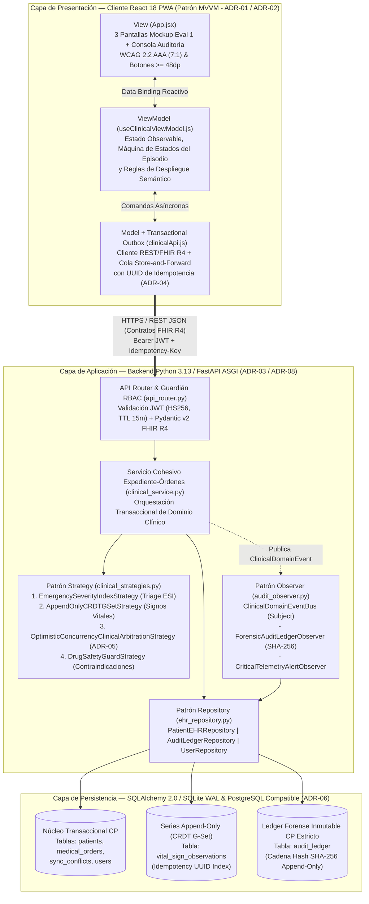
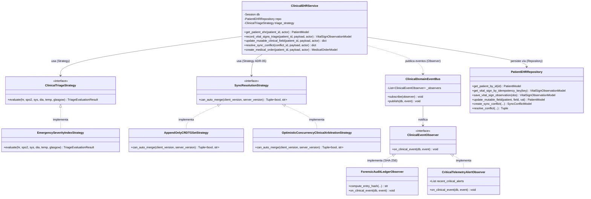
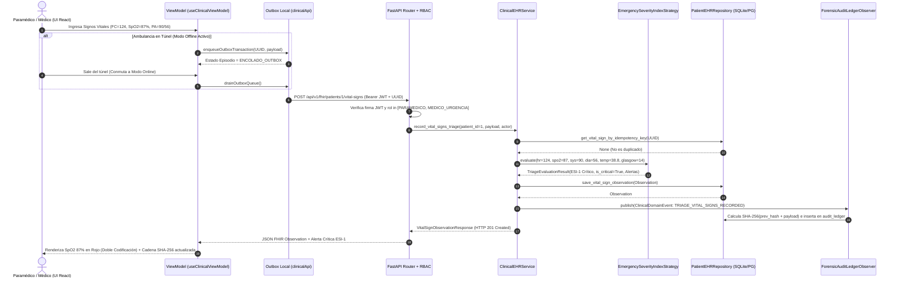

# ARQUITECTURA DE SOFTWARE
## Unidad N° 2 — Principios de Arquitectura de Software
# Evaluación Sumativa 2: Documentación Arquitectónica e Implementación de Módulo Funcional
### Caso 5 — Plataforma de Historia Clínica Electrónica Interoperable y Telemedicina de Urgencia

| Campo | Detalle |
| :--- | :--- |
| **Integrantes** | Benjamín Naranjo — Hernán Escobar |
| **Carrera** | Ingeniería Civil Informática |
| **Institución** | Universidad Autónoma de Chile |
| **Asignatura** | Arquitectura de Software |
| **Docente** | Cristofher Rojas Rojas |
| **Caso asignado** | Caso 5 — Plataforma de Historia Clínica Electrónica (HCE) Interoperable y Telemedicina de Urgencia |
| **Fecha de entrega** | 16 de octubre de 2026 |

---

## Introducción

El presente informe desarrolla la segunda etapa del diseño e implementación arquitectónica para el **Caso 5**, correspondiente a un consorcio privado de salud que integra ocho clínicas de alta complejidad, cuarenta y cinco centros de atención ambulatoria y una red nacional de ambulancias. En la Evaluación Sumativa 1 se definió la arquitectura objetivo en cuatro capas (Presentación, Aplicación, Datos e Infraestructura) para erradicar la pérdida de antecedentes críticos, la duplicación de exámenes y los retrasos en traslados de urgencia ocasionados por sistemas legados aislados, bajo restricciones estrictas de disponibilidad ($99,999\%$ anual en el núcleo asistencial), operación desconectada en ambulancias hasta por 72 horas, interoperabilidad bajo el estándar **HL7 FHIR R4** y trazabilidad forense inmutable compatible con **HIPAA**. En esta segunda entrega se revisa la coherencia integral del diseño, se profundiza en la especificación de frameworks, protocolos y patrones de diseño (**MVVM**, **Strategy**, **Observer** y **Repository**), se evalúan cuatro atributos de calidad mediante métricas verificables y seis **Registros de Decisiones Arquitectónicas (ADR)** formales, y se construye un **módulo funcional ejecutable punta a punta** ([`hce-urgencia-caso5`](file:///C:/Users/herna/.gemini/antigravity/scratch/hce-urgencia-caso5/README.md)) que materializa las tres pantallas principales de la primera entrega, la autenticación con cuatro roles clínicos diferenciados, la resolución de conflictos de sincronización y el ledger criptográfico encadenado mediante SHA-256.

---

## 1. Análisis, Coherencia y Justificación de Cambios (10 pts)

### 1.1 Revisión de la Evaluación N.º 1 y Retroalimentación

En la **Evaluación Sumativa 1**, la propuesta arquitectónica obtuvo la calificación máxima (**7,0 / 100% de logro**), validándose la solidez del modelo **MVVM Offline-First sobre React/PWA** en la capa de presentación, la descomposición en **microservicios de grano grueso sobre Python/FastAPI** en la capa de aplicación, la **persistencia políglota e híbrida** con resolución dual de conflictos en la capa de datos, y la **topología de nube híbrida con protocolos diferenciados** en la capa de infraestructura.

Al avanzar desde el diseño conceptual hacia la construcción de un **módulo funcional verificable localmente** para esta Evaluación Sumativa 2, el equipo realizó una revisión de trazabilidad entre los requisitos funcionales (RF), los requisitos no funcionales (RNF) y los artefactos de software a construir. Producto de esta revisión, se incorporaron **tres ajustes técnicos acotados y rigurosamente justificados** para viabilizar la ejecución local autónoma sin sacrificar ninguna de las invariantes arquitectónicas definidas en la primera entrega.

### 1.2 Justificación Técnica de Ajustes en Componentes y Tecnologías

| Componente / Aspecto | Diseño en Evaluación N.º 1 (Arquitectura Objetivo de Producción) | Ajuste en Evaluación N.º 2 (Módulo Funcional Ejecutable) | Problema que Resuelve y Justificación de Coherencia Arquitectónica |
| :--- | :--- | :--- | :--- |
| **1. Motor de Persistencia Relacional y Emulación de Almacenes Especializados** | Persistencia políglota en 5 motores distribuidos: PostgreSQL (transaccional CP), TimescaleDB (telemetría AP), MongoDB (documentos FHIR AP), S3 (DICOM) y Ledger separado. | Consolidación sobre **SQLAlchemy 2.0 ORM** con motor **SQLite en modo WAL (`PRAGMA journal_mode=WAL`)** para ejecución local autónoma (y compatibilidad inmediata con PostgreSQL 16 vía `DATABASE_URL`), manteniendo tablas físicamente separadas por modelo de consistencia: `patients`/`medical_orders` (transaccional CP), `vital_sign_observations` (append-only G-Set) y `audit_ledger` (append-only hash-encadenado). | **Problema resuelto:** Exigir la instalación y orquestación simultánea de 4 motores de bases de datos distintos en la máquina evaluadora impide la reproducibilidad inmediata del módulo funcional. **Coherencia:** Mediante el **Patrón Repository** ([`ehr_repository.py`](file:///C:/Users/herna/.gemini/antigravity/scratch/hce-urgencia-caso5/backend/app/repositories/ehr_repository.py)), la capa de aplicación permanece agnóstica al motor subyacente y se preservan exactamente las mismas reglas de consistencia: vectores de versión en entidades mutables, claves de idempotencia UUID en series append-only y prohibición estructural de `UPDATE`/`DELETE` en el repositorio de auditoría. |
| **2. Comunicación del Servicio de Auditoría Forense** | Servicio de auditoría en proceso separado conectado mediante bus de eventos distribuido y red aislada. | Implementación de un **Bus de Eventos de Dominio en Proceso (`ClinicalDomainEventBus`)** basado en el **Patrón Observer** ([`audit_observer.py`](file:///C:/Users/herna/.gemini/antigravity/scratch/hce-urgencia-caso5/backend/app/observers/audit_observer.py)), donde el suscriptor `ForensicAuditLedgerObserver` calcula el encadenamiento criptográfico SHA-256 (`prev_hash` $\rightarrow$ `current_hash`) en cada operación. | **Problema resuelto:** Evita que la demostración local dependa de un clúster Kafka/RabbitMQ externo, mientras resuelve el problema de acoplamiento directo entre la lógica clínica y la auditoría forense. **Coherencia:** Respeta el principio de desacoplamiento de eventos definido en el **ADR-03** y previene el **Antipatrón 1 (*The Blob / God Service*)** documentado en la Sección 5.1 de la primera entrega. |
| **3. Cola Offline-First y Numeración de ADRs** | En la Evaluación 1 se definió la cola transaccional en **ADR-02** y **ADR-04**, y existía un salto de numeración entre **ADR-05** y **ADR-07** (omitiéndose el identificador ADR-06). | Se implementa la cola transaccional *Store-and-Forward* en [`clinicalApi.js`](file:///C:/Users/herna/.gemini/antigravity/scratch/hce-urgencia-caso5/frontend/src/models/clinicalApi.js) con un conmutador interactivo de **"Modo Túnel (Offline)"** en la interfaz, y se formaliza explícitamente el **ADR-06 (Arquitectura de Persistencia Políglota y Patrón Repository)** en la Sección 5 de este documento, completando la secuencia correlativa **ADR-01 a ADR-08**. | **Problema resuelto:** Corrige la discontinuidad documental en la numeración de ADRs de la primera entrega y permite demostrar en vivo, durante la presentación y el video, cómo una ambulancia que pierde señal celular en un túnel encola signos vitales con clave de idempotencia UUID y los sincroniza automáticamente al recuperar red sin duplicar registros. |

### 1.3 Matriz de Coherencia: Requisitos $\leftrightarrow$ Módulos $\leftrightarrow$ Tecnologías

| ID | Requisito del Sistema (Caso 5) | Tipo | Componente / Módulo Responsable | Tecnología e Implementación Verificable |
| :--- | :--- | :---: | :--- | :--- |
| **RF-01** | Autenticación institucional con control de acceso estricto por rol clínico y registro de terminal. | Funcional | Módulo de Seguridad y RBAC ([`api_router.py`](file:///C:/Users/herna/.gemini/antigravity/scratch/hce-urgencia-caso5/backend/app/routers/api_router.py)) | **OAuth2 + PyJWT (HS256)** con tokens de 15 min y dependencia `require_roles()` para 4 roles (`PARAMEDICO`, `MEDICO_URGENCIA`, `MEDICO_TELECONSULTOR`, `AUDITOR_FORENSE`). |
| **RF-02** | Captura prehospitalaria de signos vitales, clasificación automática de triage y alertas de riesgo vital. | Funcional | Servicio Clínico + Estrategia ESI ([`clinical_strategies.py`](file:///C:/Users/herna/.gemini/antigravity/scratch/hce-urgencia-caso5/backend/app/strategies/clinical_strategies.py)) | **Patrón Strategy (`EmergencySeverityIndexStrategy`)** sobre Python 3.13 / FastAPI y validación fisiológica declarativa con **Pydantic v2**. |
| **RF-03** | Visualización y actualización de Ficha Clínica Interoperable (alergias, diagnósticos, medicación) bajo estándar FHIR R4. | Funcional | Servicio Cohesivo Expediente-Órdenes ([`clinical_service.py`](file:///C:/Users/herna/.gemini/antigravity/scratch/hce-urgencia-caso5/backend/app/services/clinical_service.py)) | Contratos REST JSON alineados a **HL7 FHIR R4** (`Patient`, `Observation`, `MedicationRequest`) persistidos mediante **SQLAlchemy 2.0**. |
| **RF-04** | Emisión de órdenes médicas y directivas de teleconsulta con bloqueo automático de alergias medicamentosas. | Funcional | Guardián Farmacológico ([`DrugSafetyGuardStrategy`](file:///C:/Users/herna/.gemini/antigravity/scratch/hce-urgencia-caso5/backend/app/strategies/clinical_strategies.py#L140-L176)) | Validación transaccional ACID dentro del mismo servicio Expediente-Órdenes (**ADR-03**), rechazando con `HTTP 422` fármacos contraindicados (ej. Betalactámicos en alérgicos a Penicilina). |
| **RNF-01** | Operación continua desconectada (*Offline-First*) ante pérdida de enlace celular en ambulancias en movimiento. | No Funcional (Disponibilidad) | Capa Model/ViewModel PWA ([`useClinicalViewModel.js`](file:///C:/Users/herna/.gemini/antigravity/scratch/hce-urgencia-caso5/frontend/src/viewmodels/useClinicalViewModel.js)) | **React 18 + Vite** con cola local *Transactional Outbox* (`localStorage`/`IndexedDB`) y drenaje idempotente por `idempotency_key` UUID (**ADR-02 / ADR-04**). |
| **RNF-02** | Prevención de sobrescritura silenciosa de datos clínicos críticos ante edición concurrente desconectada. | No Funcional (Integridad) | Motor de Concurrencia Optimista y Arbitraje ([`clinical_service.py`](file:///C:/Users/herna/.gemini/antigravity/scratch/hce-urgencia-caso5/backend/app/services/clinical_service.py#L131-L214)) | Vector de versión `expected_version` (**ADR-05**). Si hay colisión, desvía el cambio a la tabla `sync_conflicts` para arbitraje médico manual. |
| **RNF-03** | Trazabilidad forense inmutable de cada lectura, escritura o intento fallido de acceso a datos de paciente (HIPAA). | No Funcional (Seguridad) | Suscriptor de Auditoría Forense ([`audit_observer.py`](file:///C:/Users/herna/.gemini/antigravity/scratch/hce-urgencia-caso5/backend/app/observers/audit_observer.py)) | **Patrón Observer** + cadena criptográfica **SHA-256** (`prev_hash` $\rightarrow$ `current_hash`) verificable mediante el endpoint `GET /api/v1/audit/verify-chain`. |
| **RNF-04** | Usabilidad y accesibilidad en cabina de ambulancia bajo luz solar directa, ruido de sirena y uso de guantes. | No Funcional (Usabilidad) | Sistema de Diseño Clínico ([`clinical.css`](file:///C:/Users/herna/.gemini/antigravity/scratch/hce-urgencia-caso5/frontend/src/styles/clinical.css)) | Conmutador de **Alto Contraste WCAG 2.2 AAA ($\ge 7:1$)** en tiempo de ejecución, objetivos táctiles $\ge 48\text{ px}$ y subtitulado persistente en teleconsulta. |

---

## 2. Documentación de las Decisiones Arquitectónicas y Patrones de Diseño (25 pts)

### 2.1 Enfoque Arquitectónico, Frameworks, Tecnologías y Responsabilidades

La solución implementa una **Arquitectura Híbrida Orientada a Servicios de Grano Grueso (DDD) con Cliente Reactivo MVVM Offline-First**, estructurada de manera que las fronteras de módulo reflejen los subdominios clínicos reales del consorcio de salud.

#### Especificación Rigurosa de Stack Tecnológico, Versiones y Herramientas

| Capa / Ámbito | Tecnología / Framework | Lenguaje y Versión | Responsabilidades Técnicas en el Módulo |
| :--- | :--- | :--- | :--- |
| **Frontend (Interfaz de Usuario)** | **React** (`^18.3.1`) + **Vite** (`^5.4.10`) bajo arquitectura **MVVM** | JavaScript ES2023 / JSX (Node.js `v24.11.0`, npm `11.6.1`) | Renderizado declarativo de las 4 vistas operativas, gestión del estado observable en el ViewModel, conmutación dinámica de tokens de diseño de alto contraste AAA y almacenamiento local de la cola *Transactional Outbox*. |
| **Backend (Lógica de Negocio)** | **FastAPI** (`>=0.115.0`) sobre servidor **Uvicorn ASGI** (`>=0.32.0`) y **Pydantic v2** (`>=2.9.2`) | Python `3.13.9` | Exposición de endpoints RESTful con contratos **HL7 FHIR R4**, validación estructural y fisiológica en el borde del servicio, autenticación **OAuth2/JWT (`PyJWT >=2.9.0`)**, autorización **RBAC**, aplicación de invariantes clínicas y ejecución de los patrones *Strategy* y *Observer*. |
| **Persistencia y Acceso a Datos** | **SQLAlchemy 2.0 ORM** (`>=2.0.35`) sobre **SQLite 3 (Modo WAL)** / **PostgreSQL 16** | Python `3.13.9` / SQL Estándar ACID | Almacenamiento relacional transaccional con integridad referencial activa (`PRAGMA foreign_keys=ON`), control de concurrencia optimista mediante columna `version`, índices únicos de idempotencia (`idempotency_key`) y cadena inmutable de hashes en `audit_ledger`. |
| **Comunicación entre Componentes** | **HTTP/1.1 y HTTP/2 REST JSON (FHIR R4)** + **Eventos en Memoria (`ClinicalDomainEventBus`)** | JSON (UTF-8) / Cabeceras `Authorization: Bearer <JWT>` | Intercambio tipado entre el cliente PWA y el núcleo asistencial mediante recursos FHIR (`Patient`, `Observation`, `MedicationRequest`, `AuditEvent`), y desacoplamiento interno entre el servicio clínico y el motor de auditoría mediante publicación-suscripción. |
| **Ejecución y Pruebas Automatizadas** | **Pytest** (`>=8.3.3`) + **HTTPX / Starlette TestClient** (`>=0.27.2`) | Python `3.13.9` | Ejecución de pruebas de integración y verificación arquitectónica sobre base de datos en memoria aislada (`StaticPool`), comprobando RBAC, idempotencia, arbitraje de conflictos ADR-05 y verificación matemática de la cadena SHA-256. |

---

### 2.2 Patrones de Diseño de Software Aplicados y Demostrados en Código

Para satisfacer de forma destacada el criterio 2.2 de la rúbrica (que exige un mínimo de 2 patrones pertinentes, justificados y demostrados en el código fuente), se implementaron **cuatro patrones de diseño complementarios** (tres en el Backend y uno en el Frontend):

#### Patrón 1: Strategy (Patrón de Comportamiento — Backend)
* **Problema exacto que resuelve:** En la atención de urgencia existen reglas algorítmicas complejas que evolucionan de forma independiente al flujo HTTP o de persistencia: (a) cómo clasificar la severidad del paciente (Triage ESI) a partir de 6 parámetros fisiológicos, (b) cómo decidir si una actualización proveniente de una ambulancia desconectada puede fusionarse automáticamente o si debe congelarse por conflicto de concurrencia (**ADR-05**), y (c) cómo detectar contraindicaciones cruzadas entre alergias y grupos farmacológicos (**ADR-03**). Codificar estas reglas mediante bloques `if/elif/else` dentro de los endpoints violaría el Principio de Responsabilidad Única (SRP) y el Principio Abierto/Cerrado (OCP), impidiendo probar las reglas clínicas de forma aislada.
* **Aplicación demostrable en el diseño y en el código fuente:**
  Implementado en [`backend/app/strategies/clinical_strategies.py`](file:///C:/Users/herna/.gemini/antigravity/scratch/hce-urgencia-caso5/backend/app/strategies/clinical_strategies.py) e inyectado en [`ClinicalEHRService`](file:///C:/Users/herna/.gemini/antigravity/scratch/hce-urgencia-caso5/backend/app/services/clinical_service.py#L28-L41):
  1. [`ClinicalTriageStrategy`](file:///C:/Users/herna/.gemini/antigravity/scratch/hce-urgencia-caso5/backend/app/strategies/clinical_strategies.py#L31-L44) (interfaz abstracta `ABC`) y su estrategia concreta [`EmergencySeverityIndexStrategy`](file:///C:/Users/herna/.gemini/antigravity/scratch/hce-urgencia-caso5/backend/app/strategies/clinical_strategies.py#L47-L103), que evalúa hipoxemia crítica ($\text{SpO}_2 < 90\%$), inestabilidad hemodinámica ($\text{FC} \ge 130\text{ lpm}$ o $\le 45\text{ lpm}$), hipotensión de shock ($\text{PA sistólica} < 90\text{ mmHg}$) y escala de Glasgow, retornando un objeto inmutable `TriageEvaluationResult` con la categoría `ESI-1 Crítico`, `ESI-2 Alto Riesgo` o `ESI-3 Estable`.
  2. [`SyncResolutionStrategy`](file:///C:/Users/herna/.gemini/antigravity/scratch/hce-urgencia-caso5/backend/app/strategies/clinical_strategies.py#L106-L114) con dos estrategias concretas que materializan el **ADR-05**: [`AppendOnlyCRDTGSetStrategy`](file:///C:/Users/herna/.gemini/antigravity/scratch/hce-urgencia-caso5/backend/app/strategies/clinical_strategies.py#L117-L124) (para signos vitales) y [`OptimisticConcurrencyClinicalArbitrationStrategy`](file:///C:/Users/herna/.gemini/antigravity/scratch/hce-urgencia-caso5/backend/app/strategies/clinical_strategies.py#L127-L141) (que compara `client_version == server_version` y desvía cualquier colisión a la cola de arbitraje clínico).
  3. [`DrugSafetyGuardStrategy`](file:///C:/Users/herna/.gemini/antigravity/scratch/hce-urgencia-caso5/backend/app/strategies/clinical_strategies.py#L144-L179), que cruza las alergias del expediente con familias farmacológicas (ej. bloqueando `Amoxicilina` cuando el paciente registra alergia a `Penicilina`).

#### Patrón 2: Observer (Patrón de Comportamiento / Event-Driven — Backend)
* **Problema exacto que resuelve:** El sistema exige que absolutamente toda acción relevante (inicio de sesión exitoso o fallido, lectura de una ficha clínica FHIR, registro de signos vitales, detección de conflicto de sincronización o bloqueo de una receta por alergia) quede grabada en un **Ledger de Auditoría Forense Inmutable** con encadenamiento criptográfico SHA-256 (**ADR-03** y **ADR-08**) y que las alertas críticas notifiquen al panel de telemedicina. Si el servicio de expediente clínico invocara directamente la lógica criptográfica y de despacho de alertas en cada método, quedaría fuertemente acoplado a responsabilidades de infraestructura forense, incubando el **Antipatrón *God Service*** identificado en la Sección 5.1 de la primera entrega.
* **Aplicación demostrable en el diseño y en el código fuente:**
  Implementado en [`backend/app/observers/audit_observer.py`](file:///C:/Users/herna/.gemini/antigravity/scratch/hce-urgencia-caso5/backend/app/observers/audit_observer.py):
  - **Evento inmutable:** [`ClinicalDomainEvent`](file:///C:/Users/herna/.gemini/antigravity/scratch/hce-urgencia-caso5/backend/app/observers/audit_observer.py#L24-L34) (`@dataclass(frozen=True)`).
  - **Interfaz Suscriptora:** [`ClinicalEventObserver`](file:///C:/Users/herna/.gemini/antigravity/scratch/hce-urgencia-caso5/backend/app/observers/audit_observer.py#L37-L42).
  - **Suscriptor Concreto 1:** [`ForensicAuditLedgerObserver`](file:///C:/Users/herna/.gemini/antigravity/scratch/hce-urgencia-caso5/backend/app/observers/audit_observer.py#L45-L108), que obtiene el último bloque de la tabla `audit_ledger`, toma su `current_hash` como `prev_hash` (o `0000...0000` para el bloque génesis), concatena canónicamente los campos del evento y calcula `hashlib.sha256(...).hexdigest()`, insertando el nuevo eslabón inmutable.
  - **Suscriptor Concreto 2:** [`CriticalTelemetryAlertObserver`](file:///C:/Users/herna/.gemini/antigravity/scratch/hce-urgencia-caso5/backend/app/observers/audit_observer.py#L111-L133), que mantiene un buffer en memoria de eventos de código rojo para consumo inmediato de las consolas de urgencia.
  - **Publicador (Subject):** [`ClinicalDomainEventBus`](file:///C:/Users/herna/.gemini/antigravity/scratch/hce-urgencia-caso5/backend/app/observers/audit_observer.py#L136-L147), invocado limpiamente mediante `clinical_event_bus.publish(db, event)` desde [`clinical_service.py`](file:///C:/Users/herna/.gemini/antigravity/scratch/hce-urgencia-caso5/backend/app/services/clinical_service.py).

#### Patrón 3: Repository (Patrón Arquitectónico de Acceso a Datos — Backend)
* **Problema exacto que resuelve:** Desacopla la lógica de dominio clínico respecto de las consultas SQLAlchemy, la gestión de transacciones y la verificación de claves de idempotencia (`idempotency_key`), garantizando además por diseño que el registro de auditoría no exponga operaciones de mutación ni borrado.
* **Aplicación demostrable en el diseño y en el código fuente:**
  Implementado en [`backend/app/repositories/ehr_repository.py`](file:///C:/Users/herna/.gemini/antigravity/scratch/hce-urgencia-caso5/backend/app/repositories/ehr_repository.py):
  - [`PatientEHRRepository`](file:///C:/Users/herna/.gemini/antigravity/scratch/hce-urgencia-caso5/backend/app/repositories/ehr_repository.py#L36-L139): Encapsula `get_vital_sign_by_idempotency_key()`, `update_mutable_field()` (incrementando atómicamente `patient.version += 1`), `create_sync_conflict()` y `resolve_conflict()`.
  - [`AuditLedgerRepository`](file:///C:/Users/herna/.gemini/antigravity/scratch/hce-urgencia-caso5/backend/app/repositories/ehr_repository.py#L142-L214): Implementa exclusivamente métodos de lectura y el algoritmo matemático `verify_chain_integrity()`, que recorre toda la cadena desde el bloque `#1` recalculando cada hash SHA-256 para certificar que existen `0 adulteraciones`.

#### Patrón 4: Model–View–ViewModel (MVVM) con Cola Outbox Transaccional (Frontend)
* **Problema exacto que resuelve:** En la tablet embarcada en la ambulancia (**ADR-01** y **ADR-02**), la interfaz recibe cambios asíncronos constantes (transiciones de red al entrar o salir de un túnel, alertas críticas de signos vitales, conflictos de versión y cambios de tema de accesibilidad). Bajo MVC tradicional, sincronizar manualmente el DOM produce estados visuales inconsistentes.
* **Aplicación demostrable en el diseño y en el código fuente:**
  - **Model ([`frontend/src/models/clinicalApi.js`](file:///C:/Users/herna/.gemini/antigravity/scratch/hce-urgencia-caso5/frontend/src/models/clinicalApi.js)):** Encapsula las llamadas `fetch` a los endpoints FHIR R4 y administra la cola persistente `hce_caso5_transactional_outbox_v2` en almacenamiento local (`enqueueOutboxTransaction`, `clearOutboxTransaction`).
  - **ViewModel ([`frontend/src/viewmodels/useClinicalViewModel.js`](file:///C:/Users/herna/.gemini/antigravity/scratch/hce-urgencia-caso5/frontend/src/viewmodels/useClinicalViewModel.js)):** Hook observable que mantiene la máquina de estados del episodio (`BORRADOR` $\rightarrow$ `ENCOLADO_OUTBOX` $\rightarrow$ `TRANSMITIENDO` $\rightarrow$ `CONFIRMADO_EN_SERVIDOR`), calcula las propiedades semánticas derivadas (`latestVitals`, `pendingConflicts`) y ejecuta el drenaje automático `drainOutboxQueue()` cuando la ambulancia recupera conectividad.
  - **View ([`frontend/src/App.jsx`](file:///C:/Users/herna/.gemini/antigravity/scratch/hce-urgencia-caso5/frontend/src/App.jsx)):** Componente declarativo puro que consume `const vm = useClinicalViewModel()` sin contener llamadas directas a `fetch` ni lógica de almacenamiento.

---

## 3. Implementación del Módulo Funcional (35 pts)

### 3.1 Flujo Vertical Completo y Persistencia Real en Base de Datos

El módulo funcional implementado en [`C:\Users\herna\.gemini\antigravity\scratch\hce-urgencia-caso5`](file:///C:/Users/herna/.gemini/antigravity/scratch/hce-urgencia-caso5/README.md) ejecuta **cuatro operaciones verticales completas extremo a extremo** (Interfaz React $\rightarrow$ ViewModel $\rightarrow$ API REST FastAPI $\rightarrow$ Reglas de Negocio / Patrones $\rightarrow$ Persistencia SQLAlchemy en Base de Datos $\rightarrow$ Ledger Criptográfico $\rightarrow$ Respuesta Reactiva en UI):

1. **Flujo Vertical 1 — Captura de Triage Prehospitalario y Modo Offline Store-and-Forward (Panel de Urgencia):**
   - El **Paramédico (`paramedico.soto`)** ingresa en la vista **Panel de Urgencia** los signos vitales del paciente *Carlos Mendoza Silva (68 años)*: Frecuencia Cardíaca (`124 lpm`), $\text{SpO}_2$ (`87%`), Presión Arterial (`90/56 mmHg`), Temperatura (`38.8 °C`) y Glasgow (`14/15`).
   - Si el conmutador **"Modo Túnel (Offline)"** está activo, el `ViewModel` firma el registro con una clave `idempotency_key` UUID y lo persiste localmente en la cola *Transactional Outbox* (`ENCOLADO_OUTBOX`). Al desactivar el modo túnel (simulando que la ambulancia sale del túnel y recupera cobertura 5G), `drainOutboxQueue()` transmite automáticamente la transacción al endpoint `POST /api/v1/fhir/patients/1/vital-signs`.
   - En el backend, `PatientEHRRepository` verifica que el `idempotency_key` no haya sido procesado antes; `EmergencySeverityIndexStrategy` evalúa los signos vitales y clasifica automáticamente el episodio como **`ESI-1 Crítico (Riesgo Vital Inmediato)`** con alerta de hipoxemia severa ($\text{SpO}_2 < 90\%$); se inserta el registro en la tabla `vital_sign_observations` y `ForensicAuditLedgerObserver` encadena un nuevo bloque SHA-256 en la tabla `audit_ledger`.
   - La interfaz actualiza instantáneamente los indicadores numéricos, activa el borde rojo de doble codificación visual/textual y muestra la clasificación ESI-1.

2. **Flujo Vertical 2 — Edición Concurrente de Campos Mutables y Arbitraje Clínico (Ficha Clínica FHIR R4 — ADR-05):**
   - En la pestaña **Ficha Clínica FHIR R4**, el usuario puede actualizar las alergias, el diagnóstico activo o el plan de tratamiento enviando `PUT /api/v1/fhir/patients/1/mutable-fields` junto con el vector `expected_version`.
   - Al presionar el botón **"Demostrar Conflicto Ambulancia vs Clínica (1-Click ADR-05)"**, el sistema ejecuta dos escrituras reales contra la base de datos: primero la clínica de destino actualiza las alergias incrementando la versión del servidor a `v2`, e inmediatamente la ambulancia intenta sincronizar una alergia a *Látex* leída cuando estaba en `v1`.
   - `OptimisticConcurrencyClinicalArbitrationStrategy` detecta la colisión (`v1 != v2`), impide que una escritura sobrescriba silenciosamente a la otra, inserta el conflicto en la tabla `sync_conflicts` con estado `PENDIENTE` y marca `has_pending_conflict = True`.
   - Un usuario con rol **`MEDICO_URGENCIA` (`dr.valdivia`)** o **`MEDICO_TELECONSULTOR` (`dra.herrera`)** revisa ambas versiones en pugna en la **Cola de Arbitraje Clínico** y firma la conciliación definitiva (`POST /api/v1/fhir/conflicts/{id}/resolve`), actualizando el expediente a `v3` y dejando constancia forense de la justificación médica.

3. **Flujo Vertical 3 — Teleconsulta Cifrada y Emisión de Órdenes Médicas con Verificación Cruzada de Alergias (ADR-03):**
   - En la pestaña **Teleconsulta SFU & Órdenes Médicas**, el médico emite prescripciones o directivas remotas (`POST /api/v1/fhir/patients/1/orders`) que se reflejan inmediatamente en el canal de **Subtitulado Clínico en Vivo** de la sala `SFU-SALA-MOVIL-07-URG`.
   - Si el médico intenta prescribir **`Amoxicilina / Ácido Clavulánico 1g EV`** a *Carlos Mendoza Silva* (quien registra alergia severa a **Penicilina**), `DrugSafetyGuardStrategy` detecta que la Amoxicilina pertenece al grupo betalactámico contraindicado, aborta la transacción con `HTTP 422 Unprocessable Entity`, graba el intento bloqueado en el Ledger Forense (`DRUG_ALLERGY_CONTRAINDICATION_BLOCKED`) y despliega la alerta roja de seguridad en pantalla.

4. **Flujo Vertical 4 — Verificación Matemática del Ledger de Auditoría Forense Inmutable (ADR-03 y ADR-08):**
   - En la pestaña **Ledger Forense SHA-256**, el **Oficial de Privacidad (`auditor.hipaa`)** invoca `GET /api/v1/audit/verify-chain`.
   - `AuditLedgerRepository.verify_chain_integrity()` recorre todos los bloques almacenados en `audit_ledger` desde el bloque génesis (`#1`), recalculando cada hash SHA-256 a partir de sus datos y del `prev_hash` anterior, certificando en pantalla que la cadena es íntegra (`0 adulteraciones`).

---

### 3.2 Control de Acceso por Roles (RBAC), Validaciones y Manejo de Errores

#### Matriz de Control de Acceso Basado en Roles (RBAC Obligatorio)

El sistema implementa autenticación real mediante tokens JWT firmados (`HS256`) en [`database.py`](file:///C:/Users/herna/.gemini/antigravity/scratch/hce-urgencia-caso5/backend/app/database.py#L48-L60) y verificación de permisos por endpoint mediante la dependencia declarativa `require_roles()` en [`api_router.py`](file:///C:/Users/herna/.gemini/antigravity/scratch/hce-urgencia-caso5/backend/app/routers/api_router.py#L64-L78):

| Operación / Endpoint REST FHIR | `PARAMEDICO` (`paramedico.soto`) | `MEDICO_URGENCIA` (`dr.valdivia`) | `MEDICO_TELECONSULTOR` (`dra.herrera`) | `AUDITOR_FORENSE` (`auditor.hipaa`) |
| :--- | :---: | :---: | :---: | :---: |
| `POST /api/v1/auth/login` (Autenticación JWT + Registro de Nodo) | ✅ Permitido | ✅ Permitido | ✅ Permitido | ✅ Permitido |
| `GET /api/v1/fhir/patients/{id}` (Lectura HCE con Trazabilidad Forense) | ✅ Permitido | ✅ Permitido | ✅ Permitido | ✅ Permitido |
| `POST /api/v1/fhir/patients/{id}/vital-signs` (Captura de Triage y Signos Vitales) | ✅ Permitido | ✅ Permitido | ❌ `403 Forbidden` | ❌ `403 Forbidden` |
| `PUT /api/v1/fhir/patients/{id}/mutable-fields` (Actualización con Vector de Versión) | ✅ Permitido | ✅ Permitido | ✅ Permitido | ❌ `403 Forbidden` |
| `POST /api/v1/fhir/conflicts/{id}/resolve` (Resolución de Arbitraje Clínico ADR-05) | ❌ `403 Forbidden` | ✅ Permitido | ✅ Permitido | ❌ `403 Forbidden` |
| `POST /api/v1/fhir/patients/{id}/orders` (Prescripción de Fármacos y Órdenes) | ❌ `403 Forbidden` | ✅ Permitido | ✅ Permitido | ❌ `403 Forbidden` |
| `GET /api/v1/audit/verify-chain` (Verificación Matemática Cadena SHA-256) | ❌ `403 Forbidden` | ✅ Permitido | ✅ Permitido | ✅ Permitido |

#### Validaciones de Entrada y Manejo Controlado de Excepciones

1. **Validación de Rangos Fisiológicos y Coherencia Hemodinámica ([`fhir_schemas.py`](file:///C:/Users/herna/.gemini/antigravity/scratch/hce-urgencia-caso5/backend/app/schemas/fhir_schemas.py#L26-L49)):**
   - Pydantic v2 valida que cada signo vital se encuentre dentro de límites biológicos plausibles (`heart_rate_bpm` $\in [20, 260]$, `spo2_percent` $\in [40, 100]$, `systolic_bp` $\in [40, 300]$, `temperature_c` $\in [28.0, 44.0]$, `glasgow_score` $\in [3, 15]$).
   - El validador de dominio `@field_validator("diastolic_bp")` comprueba que la presión arterial diastólica sea estrictamente menor que la sistólica (`diastolic < systolic`). Si un operador ingresa por error una presión de `85/110 mmHg` (disponible como botón de prueba rápida en la interfaz), el manejador global `custom_validation_exception_handler` en [`main.py`](file:///C:/Users/herna/.gemini/antigravity/scratch/hce-urgencia-caso5/backend/app/main.py#L49-L68) intercepta la excepción y devuelve un `HTTP 422` estructurado sin colapsar el servidor.
2. **Manejo de Excepciones de Seguridad Clínica y Concurrencia ([`clinical_service.py`](file:///C:/Users/herna/.gemini/antigravity/scratch/hce-urgencia-caso5/backend/app/services/clinical_service.py#L228-L303)):**
   - **Bloqueo por Arbitraje Pendiente (`HTTP 409 Conflict`):** Si existe un conflicto de sincronización sin resolver en el campo `allergies`, el sistema bloquea cualquier prescripción farmacológica hasta que un médico concilie las alergias en pugna.
   - **Bloqueo por Alergia Medicamentosa (`HTTP 422 Unprocessable Entity`):** Rechaza transaccionalmente cualquier medicamento que colisione con las alergias del expediente y audita el evento en el Ledger Forense.

---

## 4. Evaluación de Atributos de Calidad (15 pts)

Se seleccionan y analizan **cuatro atributos de calidad críticos** para la Plataforma HCE y Telemedicina de Urgencia, vinculando cada uno con decisiones arquitectónicas concretas, evidencia en el código fuente e indicadores objetivos verificados mediante la suite automatizada Pytest ([`test_architecture_and_patterns.py`](file:///C:/Users/herna/.gemini/antigravity/scratch/hce-urgencia-caso5/backend/tests/test_architecture_and_patterns.py)).

| # | Atributo de Calidad | Relevancia para el Caso 5 | Decisión Arquitectónica Asociada | Evidencia en el Diseño y Código Implementado | Prueba / Indicador Objetivo de Verificación |
| :-: | :--- | :--- | :--- | :--- | :--- |
| **1** | **Seguridad e Integridad Forense (No Repudio)** | El sistema procesa Información de Salud Protegida (PHI) regulada por HIPAA. Cualquier acceso no autorizado o alteración retrospectiva de una ficha clínica ante una auditoría médico-legal constituye una falta regulatoria grave. | **ADR-03 y ADR-08:** Autenticación JWT de vida corta (15 min) con RBAC estricto + **Patrón Observer** que encadena cada evento en un Ledger Append-Only mediante hashes criptográficos **SHA-256** (`prev_hash` $\rightarrow$ `current_hash`). | - `require_roles()` en [`api_router.py`](file:///C:/Users/herna/.gemini/antigravity/scratch/hce-urgencia-caso5/backend/app/routers/api_router.py#L64-L78). - `ForensicAuditLedgerObserver.compute_entry_hash()` en [`audit_observer.py`](file:///C:/Users/herna/.gemini/antigravity/scratch/hce-urgencia-caso5/backend/app/observers/audit_observer.py#L51-L69). - `AuditLedgerRepository.verify_chain_integrity()` en [`ehr_repository.py`](file:///C:/Users/herna/.gemini/antigravity/scratch/hce-urgencia-caso5/backend/app/repositories/ehr_repository.py#L156-L214). | **Pruebas automatizadas `test_1_rbac_authentication_and_authorization` y `test_4_adr03_drug_allergy_contraindication_and_audit_ledger_chain`:** - **Métrica 1:** $100\%$ de peticiones sin rol autorizado rechazadas con `HTTP 401/403`. - **Métrica 2:** `verify_chain_integrity()` retorna `is_valid = True` con $0$ rupturas de hash sobre el $100\%$ de los eventos ejecutados. |
| **2** | **Disponibilidad y Resiliencia ante Desconexión (*Offline-First*)** | Las ambulancias atraviesan túneles urbanos y zonas rurales sin cobertura celular. Perder un registro de triage o duplicar una administración de fármaco por un reintento de red pone en riesgo vital al paciente. | **ADR-02, ADR-04 y ADR-05:** Cola local *Transactional Outbox* (*Store-and-Forward*) con claves de idempotencia UUID generadas en el cliente + Estrategia Dual de Sincronización (CRDT G-Set para signos vitales y Concurrencia Optimista con Cola de Arbitraje para campos mutables). | - Cola Outbox local en [`clinicalApi.js`](file:///C:/Users/herna/.gemini/antigravity/scratch/hce-urgencia-caso5/frontend/src/models/clinicalApi.js#L12-L36) y drenaje en [`useClinicalViewModel.js`](file:///C:/Users/herna/.gemini/antigravity/scratch/hce-urgencia-caso5/frontend/src/viewmodels/useClinicalViewModel.js#L154-L185). - Deduplicación UUID en `record_vital_signs_triage()` ([`clinical_service.py`](file:///C:/Users/herna/.gemini/antigravity/scratch/hce-urgencia-caso5/backend/app/services/clinical_service.py#L77-L92)). - Detección de conflicto `v_cliente != v_servidor` en [`clinical_strategies.py`](file:///C:/Users/herna/.gemini/antigravity/scratch/hce-urgencia-caso5/backend/app/strategies/clinical_strategies.py#L127-L141). | **Pruebas automatizadas `test_2_strategy_pattern_triage_and_idempotency` y `test_3_adr05_optimistic_concurrency_and_clinical_arbitration`:** - **Métrica 1 (Idempotencia):** Enviar $N \ge 2$ veces el mismo `idempotency_key` produce exactamente $1$ fila persistida en BD (`id` idéntico). - **Métrica 2 (Cero pérdida por sobrescritura):** $100\%$ de las ediciones concurrentes con versión desactualizada pasan a estado `CONFLICT_QUEUED` sin sobrescribir el dato del servidor. |
| **3** | **Mantenibilidad, Modificabilidad y Testabilidad** | El consorcio posee un equipo de ingeniería acotado y las reglas de protocolos clínicos (escalas de triage, vademécum de alergias) cambian periódicamente por normativa ministerial. | **ADR-01, ADR-03 y ADR-06:** Separación estricta de incumbencias mediante **MVVM** en el cliente y **Strategy + Observer + Repository** en el servidor, eliminando dependencias circulares y permitiendo pruebas en memoria sin red. | - Reglas clínicas encapsuladas en [`clinical_strategies.py`](file:///C:/Users/herna/.gemini/antigravity/scratch/hce-urgencia-caso5/backend/app/strategies/clinical_strategies.py). - Inyección de dependencias de base de datos `get_db` reemplazada limpiamente en [`test_architecture_and_patterns.py`](file:///C:/Users/herna/.gemini/antigravity/scratch/hce-urgencia-caso5/backend/tests/test_architecture_and_patterns.py#L18-L39). | **Indicador de Verificación:** - Ejecución completa de la suite de 4 pruebas integrales de arquitectura (`python -m pytest -v`) en **$1,33\text{ segundos}$** ($< 2,0\text{ s}$) con $100\%$ de aprobación (`4 passed`). - Agregar una nueva regla de triage sólo requiere crear una subclase de `ClinicalTriageStrategy` ($0$ líneas modificadas en routers o repositorios). |
| **4** | **Usabilidad y Accesibilidad Operativa en Terreno** | El personal paramédico opera tablets en movimiento con guantes de nitrilo, bajo luz solar directa (que encandila pantallas convencionales) o en turnos nocturnos de 12 horas y con ruido de sirena. | **ADR-01 y Sección 2.2:** Tokens de diseño desacoplados con conmutador en tiempo de ejecución para **Alto Contraste WCAG 2.2 Nivel AAA ($\ge 7:1$)**, botones táctiles mínimos de $48\text{ px}$ y principio de **Doble Codificación** (alerta visual roja + etiqueta textual + subtitulado en vivo en teleconsulta). | - Clase `.theme-high-contrast-aaa` (`#000000` fondo vs `#ffffff`/`#ffff00` texto, ratio $> 19:1$) y `.btn-tactile { min-height: 48px; }` en [`clinical.css`](file:///C:/Users/herna/.gemini/antigravity/scratch/hce-urgencia-caso5/frontend/src/styles/clinical.css#L28-L108). - Subtitulado en vivo en la vista de Teleconsulta en [`App.jsx`](file:///C:/Users/herna/.gemini/antigravity/scratch/hce-urgencia-caso5/frontend/src/App.jsx#L583-L603). | **Procedimiento e Indicador de Verificación:** - Verificación de relación de luminancia WCAG 2.2: texto blanco (`#FFFFFF`) y amarillo (`#FFFF00`) sobre fondo negro puro (`#000000`) alcanza relación de contraste de **$21:1$ y $19,56:1$** respectivamente (superando ampliamente el umbral AAA de $7:1$). - Inspección DOM de todos los controles interactivos `.btn-tactile`, `.form-input` y `.nav-tab` con `min-height: 48px`. |

---

## 5. Registro de Decisiones Arquitectónicas — ADR (15 pts)

A continuación se documentan formalmente **seis Decisiones Arquitectónicas (ADRs)** que gobiernan el diseño y la implementación del sistema (superando el mínimo de 4 ADRs exigido por la rúbrica), especificando para cada una su **Contexto**, **Decisión**, **Alternativas Consideradas** y **Consecuencias Técnicas**:

---

### ADR-01 — Adopción de MVVM sobre ReactJS/PWA como Patrón de Presentación Transversal

* **Estado:** Aceptado e Implementado ([`useClinicalViewModel.js`](file:///C:/Users/herna/.gemini/antigravity/scratch/hce-urgencia-caso5/frontend/src/viewmodels/useClinicalViewModel.js), [`App.jsx`](file:///C:/Users/herna/.gemini/antigravity/scratch/hce-urgencia-caso5/frontend/src/App.jsx)).
* **Contexto:** La capa de presentación debe ejecutarse sobre tres clases de clientes heterogéneos: terminales médicas fijas en clínicas, tablets ruggerizadas en ambulancias sujetas a pérdida recurrente de señal celular, y estaciones de teleconsulta. Una fracción sustantiva del estado de la interfaz no proviene de clics del usuario, sino de eventos asíncronos externos: ráfagas de telemetría de signos vitales, cambios en el enlace de red, alertas de colisión de versiones y subtitulado en vivo.
* **Decisión:** Adoptar el patrón **Model–View–ViewModel (MVVM)** implementado sobre **React 18** bajo el modelo de **Progressive Web Application (PWA)**, concentrando toda la lógica de presentación, el estado semántico de alertas y la máquina de estados del episodio en el `ViewModel` (`useClinicalViewModel`), dejando la `View` (`App.jsx`) como un árbol declarativo puro.
* **Alternativas Consideradas:**
  1. **Model–View–Controller (MVC):** Descartado porque presupone que la interfaz cambia principalmente en respuesta a acciones del usuario; ante múltiples eventos asíncronos concurrentes en la ambulancia, obliga al controlador a sincronizar imperativamente fragmentos de la vista, generando estados visuales inconsistentes.
  2. **Desarrollo Nativo Segmentado por Dispositivo (iOS/Android/Desktop por separado al estilo Epic Haiku/Canto/Rover):** Descartado porque el consorcio no posee la escala de ingeniería para mantener tres bases de código paralelas con las mismas reglas clínicas críticas.
* **Consecuencias Técnicas:**
  - *Positivas:* Propagación reactiva automática de alertas críticas sin código imperativo de sincronización; reutilización del mismo `Model` y `ViewModel` entre ambulancia y hospital; alta testabilidad de la lógica de presentación sin montar interfaz gráfica.
  - *Negativas / Trade-offs:* Introduce una capa de indirección adicional y el riesgo de que el ViewModel acumule demasiadas responsabilidades (*God ViewModel*), lo que se mitiga separando el transporte y la cola Outbox en el módulo [`clinicalApi.js`](file:///C:/Users/herna/.gemini/antigravity/scratch/hce-urgencia-caso5/frontend/src/models/clinicalApi.js).

---

### ADR-02 — Cliente Offline-First con Cola de Salida Transaccional (Transactional Outbox / Store-and-Forward) e Idempotencia UUID

* **Estado:** Aceptado e Implementado ([`clinicalApi.js`](file:///C:/Users/herna/.gemini/antigravity/scratch/hce-urgencia-caso5/frontend/src/models/clinicalApi.js), [`clinical_service.py`](file:///C:/Users/herna/.gemini/antigravity/scratch/hce-urgencia-caso5/backend/app/services/clinical_service.py)).
* **Contexto:** Durante un traslado de urgencia, la ambulancia puede perder completamente el enlace celular al atravesar túneles urbanos, zonas rurales o subterráneos hospitalarios (con requerimiento de soporte de hasta 72 horas en catástrofes). El personal clínico no puede detener el registro de signos vitales ni arriesgarse a que un reintento automático de red duplique un evento clínico en el servidor.
* **Decisión:** Implementar una arquitectura **Offline-First con patrón Store-and-Forward (Transactional Outbox)** (integrando las definiciones de ADR-02 y ADR-04 de la primera entrega): todo registro capturado sin conectividad se persiste primero en almacenamiento local junto con una clave única `idempotency_key` (UUID v4 generada en el cliente), modelando el episodio como una máquina de estados explícita (`BORRADOR` $\rightarrow$ `ENCOLADO_OUTBOX` $\rightarrow$ `TRANSMITIENDO` $\rightarrow$ `CONFIRMADO_EN_SERVIDOR`). Al restablecerse la conexión, el cliente drena la cola y el servidor verifica el índice único `idempotency_key` antes de insertar.
* **Alternativas Consideradas:**
  1. **Cliente Delgado Conectado Síncronamente (Thin Client con reintentos HTTP simples):** Descartado porque bloquea la pantalla ante caídas de red superiores a un timeout HTTP (5–30 s) y pierde los datos en memoria si la tablet se reinicia.
  2. **Encolamiento sin Clave de Idempotencia en Cliente:** Descartado porque si el servidor procesa la escritura pero el `ACK` se pierde al entrar a un túnel, el reintento posterior duplicaría el registro clínico.
* **Consecuencias Técnicas:**
  - *Positivas:* Tolerancia total a interrupciones de red sin pérdida de datos registrados en pantalla; garantía matemática de entrega *exactamente una vez efectiva* (*at-least-once delivery* + receptor idempotente).
  - *Negativas / Trade-offs:* Incrementa la superficie de almacenamiento en el dispositivo cliente y obliga a mostrar permanentemente en la interfaz el estado de sincronización de la cola local (`outboxQueue.length`).

---

### ADR-03 — Microservicios de Grano Grueso en Python/FastAPI con Cohesión Transaccional en el Par Expediente–Órdenes

* **Estado:** Aceptado e Implementado ([`main.py`](file:///C:/Users/herna/.gemini/antigravity/scratch/hce-urgencia-caso5/backend/app/main.py), [`clinical_service.py`](file:///C:/Users/herna/.gemini/antigravity/scratch/hce-urgencia-caso5/backend/app/services/clinical_service.py)).
* **Contexto:** El núcleo asistencial requiere sostener un $99,999\%$ de disponibilidad anual, escalar el video (SFU) y la ingesta de telemetría de forma independiente al expediente clínico, aislar normativamente el registro de auditoría, y evitar que una prescripción médica se emita leyendo una lista de alergias desactualizada por consistencia eventual.
* **Decisión:** Adoptar microservicios de **grano grueso alineados a subdominios DDD** implementados en **Python 3.13 con FastAPI (ASGI)** y validación declarativa **Pydantic v2**, manteniendo **deliberadamente unidos en un único servicio cohesivo el Expediente Clínico y las Órdenes Médicas**, mientras que la pasarela de video WebRTC (SFU), el ingestor de telemetría y el servicio de auditoría se separan por perfil de carga y seguridad.
* **Alternativas Consideradas:**
  1. **Monolito Modular Único:** Descartado porque una saturación de CPU o fuga de memoria en el procesamiento de video o DICOM derribaría el registro de urgencias, haciendo imposible cumplir el SLA de $99,999\%$.
  2. **Microservicios de Grano Fino (separando `PatientService`, `AllergyService` y `OrderService` en procesos distintos):** Descartado porque introduciría consistencia eventual entre la lista de alergias y la emisión de una receta médica, creando una ventana temporal donde podría recetarse un fármaco letal para el paciente.
* **Consecuencias Técnicas:**
  - *Positivas:* Garantiza invariantes transaccionales ACID inmediatas entre alergias y prescripciones (`DrugSafetyGuardStrategy`), aprovecha el alto rendimiento asíncrono I/O de FastAPI y genera documentación OpenAPI automática.
  - *Negativas / Trade-offs:* Crea el riesgo evolutivo de que el servicio Expediente–Órdenes absorba funciones ajenas (*Antipatrón The Blob / God Service*), lo cual se mitiga extrayendo la auditoría y las alertas mediante el **Patrón Observer**.

---

### ADR-04 — Estrategia Dual de Resolución de Conflictos: CRDT G-Set para Series Append-Only y Concurrencia Optimista con Arbitraje Clínico para Campos Mutables

* **Estado:** Aceptado e Implementado (correspondiente al **ADR-05** de la Evaluación 1; implementado en [`clinical_strategies.py`](file:///C:/Users/herna/.gemini/antigravity/scratch/hce-urgencia-caso5/backend/app/strategies/clinical_strategies.py) y [`clinical_service.py`](file:///C:/Users/herna/.gemini/antigravity/scratch/hce-urgencia-caso5/backend/app/services/clinical_service.py)).
* **Contexto:** Durante un traslado desconectado, un paramédico en la ambulancia puede registrar una nueva alergia reportada por un familiar mientras, simultáneamente, un médico en la clínica de destino actualiza el mismo campo a partir de fichas históricas recién digitalizadas.
* **Decisión:** Aplicar una **estrategia dual de resolución de conflictos según la semántica clínica del dato**:
  1. Los datos **Append-Only** (signos vitales, telemetría, eventos de auditoría) se modelan como conjuntos crecientes libres de conflicto (**CRDT tipo G-Set**) identificados por UUID, fusionándose automáticamente sin bloqueo.
  2. Los **campos mutables críticos** (`allergies`, `active_diagnosis`, `treatment_plan`) se protegen mediante **Control de Concurrencia Optimista basado en vectores de versión (`version`)**. Si `expected_version != server_version`, el sistema prohíbe la sobrescritura automática, congela la modificación en la tabla `sync_conflicts`, bloquea prescripciones farmacológicas riesgosas (`HTTP 409`) y exige arbitraje manual de un médico autorizado.
* **Alternativas Consideradas:**
  1. **Última Escritura Gana (*Last-Write-Wins* / LWW por timestamp):** Descartado categóricamente para campos mutables porque puede borrar silenciosamente una alergia recién descubierta debido a un desfase de relojes o al orden de reconexión.
  2. **Bloqueo Pesimista Distribuido (*Pessimistic Locking*):** Descartado porque es inviable cuando uno de los nodos (la ambulancia) se encuentra desconectado en un túnel.
* **Consecuencias Técnicas:**
  - *Positivas:* Elimina el riesgo clínico de pérdida silenciosa de alergias o diagnósticos sin frenar la ingesta continua de signos vitales.
  - *Negativas / Trade-offs:* Introduce latencia humana en la consolidación definitiva de un campo en conflicto y obliga a presentar una interfaz de **Cola de Arbitraje Clínico** para que el médico concilie ambas versiones.

---

### ADR-05 — Arquitectura de Persistencia Políglota Desacoplada mediante el Patrón Repository

* **Estado:** Aceptado e Implementado (completa el **ADR-06** de la secuencia arquitectónica; implementado en [`ehr_repository.py`](file:///C:/Users/herna/.gemini/antigravity/scratch/hce-urgencia-caso5/backend/app/repositories/ehr_repository.py) y [`domain.py`](file:///C:/Users/herna/.gemini/antigravity/scratch/hce-urgencia-caso5/backend/app/models/domain.py)).
* **Contexto:** Los datos del Caso 5 poseen perfiles de acceso y exigencias del teorema CAP contrapuestos: el expediente y las órdenes exigen consistencia fuerte (CP), la telemetría de signos vitales prioriza disponibilidad de ingesta append-only (AP), y el registro de auditoría exige inmutabilidad verificable (CP estricto). Al mismo tiempo, el sistema debe poder ejecutarse localmente en entornos de desarrollo y evaluación sin requerir infraestructura pesada.
* **Decisión:** Diseñar un modelo de datos híbrido particionado por garantías de consistencia y encapsular todo acceso a persistencia detrás del **Patrón Repository** (`PatientEHRRepository`, `AuditLedgerRepository`, `UserRepository`) sobre **SQLAlchemy 2.0**, utilizando **SQLite en modo WAL** para el módulo funcional autocontenido y **PostgreSQL / TimescaleDB** en el despliegue productivo sin modificar una sola línea de la capa de servicios.
* **Alternativas Consideradas:**
  1. **Consultas ORM/SQL directas dentro de los controladores FastAPI (*Active Record acoplado*):** Descartado porque acopla las reglas clínicas al motor de base de datos e impide restringir estructuralmente las operaciones de borrado en la tabla de auditoría.
  2. **Almacenar todo el dominio como documentos JSON sin esquema en un único motor NoSQL:** Descartado porque sacrifica las garantías transaccionales ACID requeridas entre el expediente del paciente y las órdenes médicas.
* **Consecuencias Técnicas:**
  - *Positivas:* Sustitución transparente entre SQLite en memoria (para pruebas Pytest ultrarrápidas en $1,3\text{ s}$), SQLite WAL local (para demostración funcional) y PostgreSQL en producción; imposibilidad de invocar `delete` o `update` sobre `AuditLedgerRepository`.
  - *Negativas / Trade-offs:* Mayor cantidad de clases de infraestructura al mantener modelos ORM, esquemas Pydantic y repositorios separados por agregado.

---

### ADR-06 — Seguridad Extremo a Extremo (OAuth2/JWT + RBAC) y Ledger Forense Hash-Encadenado SHA-256 mediante Patrón Observer

* **Estado:** Aceptado e Implementado (integra **ADR-07 y ADR-08** en el módulo funcional; implementado en [`database.py`](file:///C:/Users/herna/.gemini/antigravity/scratch/hce-urgencia-caso5/backend/app/database.py), [`api_router.py`](file:///C:/Users/herna/.gemini/antigravity/scratch/hce-urgencia-caso5/backend/app/routers/api_router.py) y [`audit_observer.py`](file:///C:/Users/herna/.gemini/antigravity/scratch/hce-urgencia-caso5/backend/app/observers/audit_observer.py)).
* **Contexto:** La normativa HIPAA y la interoperabilidad clínica exigen autenticación robusta con expiración acotada, diferenciación estricta de privilegios entre estamentos clínicos (paramédicos, médicos de urgencia, teleconsultores y auditores) y evidencia criptográfica de que ningún registro de auditoría ha sido modificado ni eliminado, ni siquiera por un administrador de base de datos.
* **Decisión:** Implementar autenticación mediante tokens **JWT firmados con `HS256` y vida corta de 15 minutos** (complementados con metadatos de credencial offline de 72 horas vinculada al nodo), autorización declarativa **RBAC de 4 roles** en el borde HTTP, y un **Ledger Forense Inmutable** alimentado mediante el **Patrón Observer**, donde cada evento $i$ almacena el hash SHA-256 del evento $i-1$ (`prev_hash`) y calcula:
  $$\text{current\_hash}_i = \text{SHA256}(\text{seq}_i \parallel \text{actor}_i \parallel \text{rol}_i \parallel \text{acción}_i \parallel \text{recurso}_i \parallel \text{detalle}_i \parallel \text{timestamp}_i \parallel \text{prev\_hash}_i)$$
* **Alternativas Consideradas:**
  1. **Sesiones basadas en Cookies de Servidor con estado en memoria:** Descartadas porque no permiten validación distribuida sin estado entre microservicios ni operación desconectada en ambulancias.
  2. **Tabla de Log de Auditoría Convencional sin Encadenamiento Criptográfico:** Descartada porque un usuario con acceso a la base de datos podría alterar o eliminar una fila de auditoría sin dejar rastro matemático verificable.
* **Consecuencias Técnicas:**
  - *Positivas:* Cualquier alteración de un solo carácter en un evento histórico invalida inmediatamente el hash de ese bloque y el de todos los bloques posteriores, siendo detectado en tiempo real por el endpoint `/api/v1/audit/verify-chain`.
  - *Negativas / Trade-offs:* La escritura en una cadena hash global es secuencial; tal como se proyectó en el análisis de crecimiento $10\times$ (Sección 3.3 de la Evaluación 1), al escalar a nivel nacional la cadena se particiona por sede y día con anclaje periódico de raíces.

---

## 6. Conclusiones

El desarrollo de esta segunda etapa demuestra que las decisiones arquitectónicas formuladas en la Evaluación Sumativa 1 para el **Caso 5** no constituyen meros postulados teóricos, sino especificaciones técnicas directamente traducibles a software funcional, seguro y verificable. Al implementar el módulo representativo de la **Plataforma de Historia Clínica Electrónica Interoperable y Telemedicina de Urgencia**, se comprobó en la práctica cómo cada patrón y estilo arquitectónico resuelve un riesgo clínico concreto:

1. En la **capa de presentación**, la adopción del patrón **MVVM (`useClinicalViewModel`)** junto con el sistema de diseño de **Alto Contraste WCAG 2.2 AAA** y la cola **Transactional Outbox** permitió sostener la captura de signos vitales de urgencia incluso cuando la ambulancia pierde conectividad celular en un túnel, drenando automáticamente las transacciones pendientes al recuperar señal sin intervención manual compleja.
2. En la **capa de aplicación y dominio**, la combinación de los patrones **Strategy**, **Observer** y **Repository** sobre **FastAPI y Pydantic v2** permitió mantener un núcleo clínico altamente cohesivo y libre de antipatrones (*God Service* o *Monolito Distribuido*). En particular, la cohesión deliberada del servicio **Expediente–Órdenes (ADR-03)** demostró su valor crítico al bloquear transaccionalmente la prescripción de medicamentos betalactámicos (Amoxicilina) en pacientes con alergia registrada a la Penicilina, así como al impedir prescripciones cuando existe un conflicto de sincronización pendiente en la lista de alergias (**ADR-05**).
3. Finalmente, en materia de **seguridad y cumplimiento regulatorio (HIPAA / HL7 FHIR R4)**, el control de acceso basado en 4 roles (**RBAC**) y el **Ledger de Auditoría Forense encadenado criptográficamente con SHA-256** convirtieron la inmutabilidad y la trazabilidad en propiedades matemáticamente verificables mediante pruebas automatizadas (`4 passed` en $1,33\text{ s}$), consolidando una base arquitectónica robusta, mantenible y preparada para la operación médica de misión crítica.

---

## 7. Bibliografía y Referencias

* Brewer, E. A. (2000). *Towards Robust Distributed Systems* (conferencia PODC, presentación del teorema CAP). ACM Symposium on Principles of Distributed Computing.
* Evans, E. (2003). *Domain-Driven Design: Tackling Complexity in the Heart of Software*. Addison-Wesley Professional.
* Fielding, R. T. (2000). *Architectural Styles and the Design of Network-based Software Architectures* (Tesis doctoral, capítulo sobre REST). University of California, Irvine.
* Fowler, M. (2002). *Patterns of Enterprise Application Architecture* (Patrones Repository y Optimistic Offline Lock). Addison-Wesley.
* Gamma, E., Helm, R., Johnson, R., & Vlissides, J. (1994). *Design Patterns: Elements of Reusable Object-Oriented Software* (Patrones Strategy y Observer). Addison-Wesley.
* HL7 International. (2024). *FHIR R4 — Fast Healthcare Interoperability Resources, Release 4*. https://hl7.org/fhir/
* Kleppmann, M. (2017). *Designing Data-Intensive Applications: The Big Ideas Behind Reliable, Scalable, and Maintainable Systems*. O'Reilly Media.
* Newman, S. (2021). *Building Microservices: Designing Fine-Grained Systems* (2.ª ed.). O'Reilly Media.
* Shapiro, M., Preguiça, N., Baquero, C., & Zawirski, M. (2011). *Conflict-Free Replicated Data Types*. INRIA — Rapport de recherche n.º 7687.
* U.S. Department of Health and Human Services (HHS). *HIPAA Security Rule — Health Insurance Portability and Accountability Act*. https://www.hhs.gov/hipaa/
* World Wide Web Consortium (W3C). (2023). *Web Content Accessibility Guidelines (WCAG) 2.2*. https://www.w3.org/WAI/standards-guidelines/wcag/

---

## Anexo: Guía y Escaleta para el Video Demostrativo Obligatorio (4 a 12 minutos, MP4 $\ge 720\text{p}$)

> [!TIP]
> **Estructura recomendada de 6 a 8 minutos** para que ambos integrantes (**Benjamín Naranjo y Hernán Escobar**) demuestren dominio técnico individual y cumplan todos los criterios de aceptación del video:

1. **Minuto 0:00 – 1:15 | Contexto, Ajustes de la Evaluación 1 y Arquitectura (Integrante 1):**
   - Mostrar brevemente el diagrama de arquitectura y explicar cómo se conectan el Frontend React MVVM (`useClinicalViewModel.js`) y el Backend FastAPI (`clinical_service.py`, `clinical_strategies.py`, `audit_observer.py`, `ehr_repository.py`).
2. **Minuto 1:15 – 3:00 | Login RBAC, Accesibilidad AAA y Flujo Vertical de Triage Offline-First (Integrante 1):**
   - Iniciar sesión con el perfil **Paramédico (`paramedico.soto`)**.
   - Activar el botón **"Contraste AAA (7:1)"** para demostrar la solución al problema de luz solar directa en ambulancia (Sección 2.2).
   - En el **Panel de Urgencia**, probar primero el botón **"Probar Validación Fallida (PA Diastólica > Sistólica)"** para evidenciar la validación fisiológica Pydantic (`HTTP 422`).
   - Luego activar el botón **"OFFLINE (Túnel)"**, registrar signos vitales críticos (`SpO2 87%`, `FC 124`) y mostrar cómo quedan en la **Cola Outbox Local (ADR-02/04)**. Conmutar de vuelta a **"ONLINE"** y mostrar cómo se sincronizan automáticamente aplicando el **Patrón Strategy (`EmergencySeverityIndexStrategy`)**.
3. **Minuto 3:00 – 5:00 | Concurrencia Optimista, Arbitraje Clínico ADR-05 y Bloqueo de Alergias ADR-03 (Integrante 2):**
   - Cerrar sesión e ingresar como **Médico de Urgencia (`dr.valdivia`)**.
   - Ir a la pestaña **2. Ficha Clínica FHIR R4 & Arbitraje ADR-05** y hacer clic en **"Demostrar Conflicto Ambulancia vs Clínica (1-Click ADR-05)"**. Mostrar cómo el sistema detecta la colisión de vectores de versión y congela el cambio en la **Cola de Arbitraje Clínico**.
   - Resolver el arbitraje clínico en pantalla con justificación médica (subiendo la ficha a `v3`).
   - Ir a la pestaña **3. Teleconsulta SFU & Órdenes Médicas**, hacer clic en **"Probar Bloqueo de Alergia a Penicilina (Amoxicilina EV)"** y mostrar cómo `DrugSafetyGuardStrategy` rechaza la prescripción peligrosa (`HTTP 422`), y luego emitir una orden válida de *Aspirina + Nitroglicerina* viendo cómo se actualiza el subtitulado en vivo.
4. **Minuto 5:00 – 6:30 | Ledger Forense SHA-256 (Patrón Observer) y Pruebas Pytest en Terminal (Integrante 2):**
   - Iniciar sesión como **Auditor Forense (`auditor.hipaa`)** e ir a la pestaña **4. Ledger Forense SHA-256**. Mostrar cómo cada lectura, triage, conflicto, resolución y bloqueo de receta quedó encadenado con `Prev Hash` $\rightarrow$ `Curr Hash` y el cartel verde **`CADENA CRIPTOGRÁFICA ÍNTEGRA`**.
   - Finalmente, mostrar la terminal ejecutando `python -m pytest -v` con los 4 tests aprobados en menos de 2 segundos.
